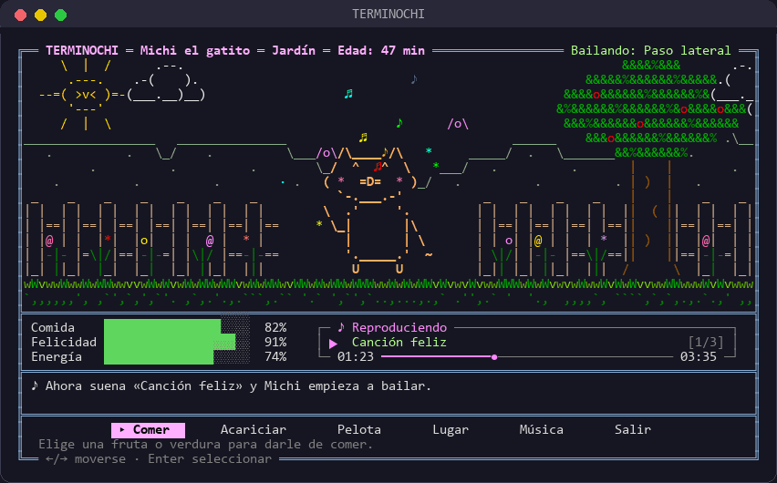
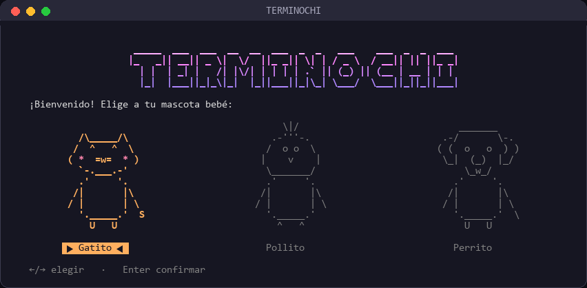
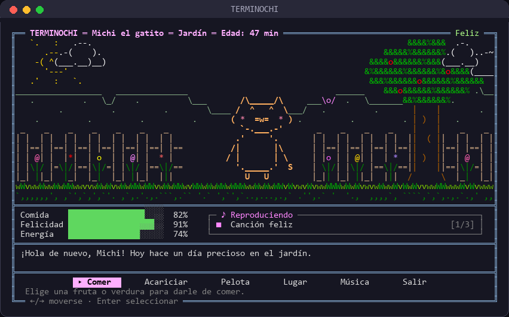
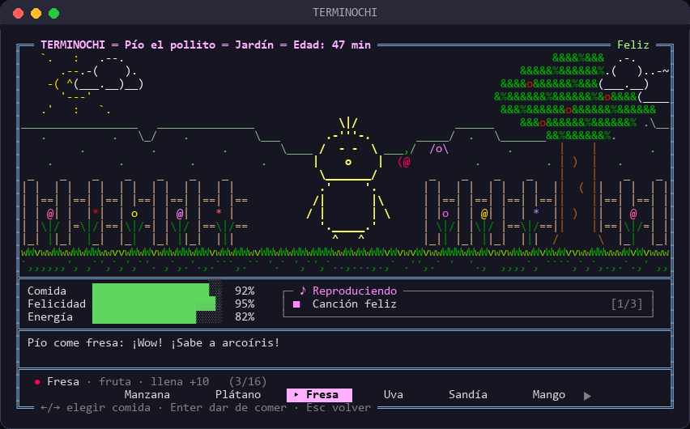
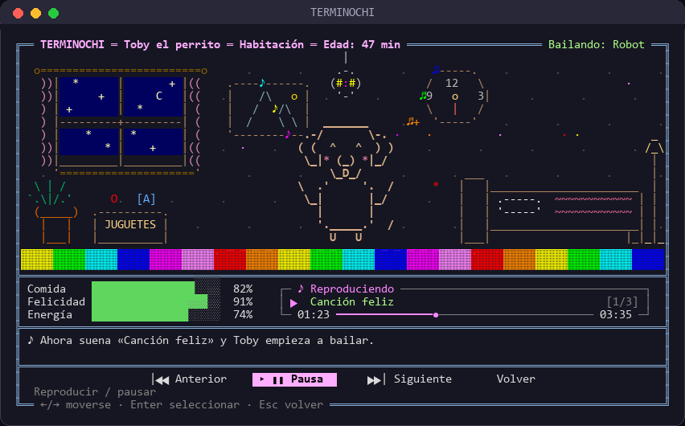

# TERMINOCHI

Mascota virtual para la terminal, hecha con ASCII art. Solo usa Python 3 (sin instalar nada en Windows).

```
python terminochi.py      # o doble clic en jugar.bat
```



## Capturas

| Elige a tu mascota | El jardín |
|:---:|:---:|
|  |  |
| **Hora de comer** | **Fiesta disco en la habitación** |
|  |  |

La interfaz mide **102 × 29** caracteres: si la ventana es más pequeña, el juego te avisa
(maximízala o reduce el zoom con `Ctrl` + `-`).

## Cómo se juega
- La primera vez eliges un **gatito, pollito o perrito** bebé y le pones nombre.
- **← / →** para moverte entre botones, **Enter** para seleccionar y **Esc** para volver.
- **Comer**: 10 frutas y 5 verduras. Hay 20 reacciones distintas; cada mascota tiene una fruta favorita y una verdura que odia (¡descúbrelas!).
- **Acariciar** y **Pelota** suben la felicidad (jugar cansa).
- **Lugar** cambia entre el **Jardín** (más divertido, cansa) y la **Habitación** (recupera energía).
- **Música**: pon audios en la carpeta `music/` y tu mascota bailará 7 coreografías (paso lateral, saltitos, giro, patadas, cabeceo, moonwalk y robot). En el jardín bailan las flores, el sol y las mariposas; en la habitación baja una bola disco. Botones: anterior, play/pausa y siguiente. El recuadro muestra el nombre de la canción sin la extensión y una barra con el tiempo.

La partida se guarda sola en `terminochi_save.json` (cada 20 s, en cada acción y al salir). La mascota no vive en segundo plano: el tiempo solo avanza mientras el juego está abierto. Borra ese archivo para empezar con otra mascota.

En Linux/macOS la música necesita `pip install pygame`.
